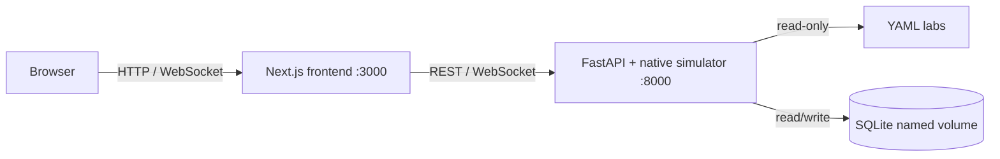

# NetSimX

NetSimX is a browser-based networking lab platform powered by a native, deterministic simulator. It runs without proprietary device images: the backend models a focused Cisco-like command set and network state directly in Python, while the frontend provides lab instructions, topology views, terminals, and grading.

> NetSimX is a learning tool, not a device emulator. Its Cisco-like CLI is a deliberately supported subset; it does not run vendor software, perform real packet forwarding, or provide vendor-certified IOS behavior.

## Features

- **Image-free local setup:** no proprietary network operating-system files or separate emulation server.
- **Deterministic simulation:** repeatable device configuration, protocol state, reachability, and grading results.
- **Browser terminal:** interact with modeled routers, switches, and hosts from the lab page.
- **Guided labs:** YAML-defined objectives, instructions, topology, command references, and checks.
- **Persistent progress:** SQLite stores lab metadata, session history, and grading results.

The supported command and protocol surface is intentionally scoped to the bundled curriculum. It includes Cisco-like user, privileged, global-configuration, interface, line, and router modes; IPv4 interface configuration and basic reachability; VLAN access and trunk configuration; 802.1Q subinterfaces and router-on-a-stick; DHCP; single-area OSPF; NTP hierarchy and authentication; SSH/device-hardening configuration; and LACP EtherChannel state. Unsupported commands return simulator feedback rather than being passed to a real device.

NetSimX currently ships with six labs:

1. Device Hardening & SSH
2. OSPF Fundamentals
3. NTP & Clock Synchronization
4. Router on a Stick I
5. Router on a Stick II
6. EtherChannel (LACP)

## Architecture

The default deployment contains two application containers:



Simulator state for an active session is held in backend memory. Durable lab metadata, session records, and grades are stored in SQLite.

## Quick start

### Prerequisites

- Docker Engine or Docker Desktop
- Docker Compose v2 (`docker compose`)

Clone and start the application:

```bash
git clone https://github.com/DiptanshuDhawan/NetSimX.git
cd NetSimX
docker compose up --build
```

Open <http://localhost:3000>. The backend remains available at <http://localhost:8000> for browser compatibility. Compose waits for backend readiness before starting the frontend.

Useful commands:

```bash
docker compose ps
docker compose logs -f backend frontend
docker compose down
```

Health endpoints are available at `/health` (compatibility), `/health/live` (process liveness), and `/health/ready` (database access plus loaded labs).

## Local development

### Backend

From `backend/`, create a virtual environment and install the direct runtime dependencies:

```bash
python -m venv .venv
python -m pip install -r requirements.txt
```

Activate `.venv`, then set the paths and run Uvicorn. For PowerShell:

```powershell
$env:DATABASE_PATH = ".\db\netlabx.db"
$env:LABS_DIR = "..\labs"
uvicorn main:app --reload --port 8000
```

For a POSIX shell:

```bash
DATABASE_PATH=./db/netlabx.db LABS_DIR=../labs uvicorn main:app --reload --port 8000
```

### Frontend

From `frontend/`:

```bash
npm ci
npm run dev
```

The frontend expects the API at `http://localhost:8000` by default. Set `NEXT_PUBLIC_API_URL` when using a different address.

### Checks

```bash
# Repository root
docker compose config
python -m compileall backend

# backend/
python -m unittest discover -p "test*.py"

# frontend/
npm run lint
npm run build
```

## Authoring labs

Each immediate child of `labs/` is treated as a lab slug and should contain a `lab.yaml` file. A lab definition supplies metadata, neutral node `kind`/`cli_profile` values, links, instructions, tasks, command references, and grading checks. Add one `solution_<node-name>.cfg` for every graded router or switch; host-only nodes may omit a solution file.

```text
labs/
└── example-lab/
    ├── lab.yaml
    ├── solution_R1.cfg
    └── solution_SW1.cfg
```

Behavioral checks currently support `ping` (an IPv4 target), `ping_node` (a named node's active address), `dhcp` (lease source/network/gateway), `ssh` (policy and exact credentials), and `telnet_refused` (reachable target with an explicit VTY refusal).

### How grading works

Grading reads one snapshot of the running lab and never changes the devices. A lab is reduced to requirements, each belonging to one node:

- **Configuration.** Every line of `solution_<node>.cfg` must be in that device's running configuration; child lines keep their parent (`interface Ethernet0/0` → `ip address ...`). Credentials are verified against the stored hash, and an `enable password` or `username ... password` does not satisfy a required `secret`. VLANs hidden by VTP server mode, `no shutdown`, an `ntp server` line without `key` (any key is accepted), and `line vty` ranges split into several blocks are checked against device state. An OSPF `network` line is met when every interface it covers runs that OSPF process in that area, however it was configured: the same statement, another one such as `network 192.168.1.1 0.0.0.0 area 0`, or `ip ospf 1 area 0` on the interface. DHCP pool names are compared without regard to case (`vlan10` satisfies `VLAN10`).
- **State implied by the solution.** Interfaces with an address or 802.1Q encapsulation must be up/up, `router ospf` needs a FULL neighbor, `ntp server` must be synchronized, `channel-group N mode active` members must be bundled, and SSH needs a domain name and 2048-bit RSA keys.
- **Checks** from `lab.yaml`, as listed above.

Tasks and score:

- In a solution file, a `! task N` comment assigns the lines after it to task N, up to the next marker. Give every check a `task: N`. State requirements follow the solution line that implies them; when they also depend on another device (the other end of a cable, an OSPF neighbor, an NTP server), they move to the later task of the two.
- A task passes when everything assigned to it passes. The score is the share of task `points` earned (default 1 per task), rounded down; it is 100% only when the whole lab passes. Tasks with nothing assigned are shown as not graded.
- `requires: [ids]` on a task makes it count only after those tasks pass. Use it for verification tasks whose checks can already pass in the untouched lab.
- Anything not assigned to a task is reported under "Other requirements".

```text
! task 3 - Configure IP Addresses
interface Ethernet0/0
 ip address 192.168.10.1 255.255.255.0
 no shutdown
```

```yaml
checks:
  - node: PC1
    task: 6
    type: ping
    target: 192.168.10.1
    description: "PC1 pings R1"
```

`POST /api/grade/{session_id}` returns `passed`, `percentage`, `tasks` (per task: `passed`, `graded`, `points`, and `findings` with the node, a message, the expected lines and the related lines currently configured) and the per-node `node_results` with `missing_lines`.

Start from one of the six existing labs, keep the directory name stable, and use only commands and modeled behaviors from the supported subset. Lab metadata is synchronized into SQLite when the backend starts; restart the backend after adding or renaming a lab.

## Persistence and migration

Docker Compose stores SQLite in the `netlabx-data` named volume at `/data/netlabx.db`. `docker compose down` retains this volume; `docker compose down -v` permanently removes it. The `labs/` directory is mounted read-only, so containers cannot modify authored lab content.

On startup, the backend safely upgrades an existing database by adding neutral `runtime_id` and `generation` session fields when absent. The legacy project-identifier field remains in the schema for compatibility, but the native runtime does not depend on it. Active native sessions cannot survive a backend process restart, so clearly identified stale native sessions are marked stopped while ambiguous legacy records are left unchanged.

Older checkouts stored `backend/db/netlabx.db` through a host bind mount. Compose now mounts that directory read-only at `/legacy-data`. On the first native startup only, if `/data/netlabx.db` does not yet exist and the legacy file is a valid non-empty SQLite database, the backend copies it through SQLite's backup API, verifies it, and atomically installs it in the named volume. An existing `/data/netlabx.db` is never overwritten, and the legacy source is never modified; keep an external backup until the upgraded history has been verified.

## Limitations

- The simulator implements a documented learning subset, not the full Cisco CLI.
- Protocol outcomes are modeled deterministically; there is no real packet capture, forwarding plane, hardware timing, or interoperability guarantee.
- Arbitrary images, vendor extensions, and unsupported protocols cannot be loaded into the native engine.
- Active terminal/runtime state is ephemeral across backend restarts, although persisted sessions and grading history remain.
- Results are intended for practice and automated feedback, not vendor certification or production network validation.

## License

Distributed under the MIT License. See `LICENSE` for details.
